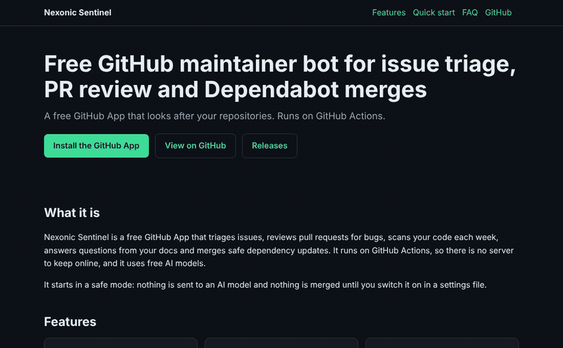

# Nexonic Sentinel

**Website: <https://shahrukhalid.github.io/nexonic-sentinel/>**

**A free GitHub App that looks after your repositories.** It triages issues, reviews pull requests for bugs, scans your code each week, answers questions from your docs and merges safe dependency updates. It runs on GitHub Actions, so there's no server to keep online, and it uses free AI models.

[](https://github.com/Shahrukhalid/nexonic-sentinel/actions/workflows/ci.yml)


<p align="center"></p>

**[Install Nexonic Sentinel](https://github.com/apps/nexonic-sentinel/installations/new)** on the repositories you choose. It starts in a safe mode: nothing is sent to an AI model and nothing is merged until you switch it on (see [Settings for your repository](#settings-for-your-repository)).

## What it does

| Where | What happens | Needs `ai = true` |
|---|---|---|
| New issues | Adds matching labels (`bug`, `enhancement`, `question`, `documentation`) when they exist, thanks the author, asks for reproduction details on short bug reports and links the docs that look relevant. Possible security reports are pointed to private vulnerability reporting. | no |
| Comments on issues | Replies once to new comments from other people on open issues: thanks, answers from your docs, or "the maintainer will decide". It never changes, labels, closes or merges anything because of a comment; each decision goes on one **Waiting on you** issue in the bot's repository and leaves it when you reply on the thread, close it, or tick its box. Off by default for other accounts (`replies = true`). | AI replies only |
| Proposals | Thinks requests and problems through like a maintainer: asks the questions that are missing, or prepares a small, concrete change (translations, docs, wording, an obvious small bug) as a pull request labelled `needs-approval`, crediting the person who asked. It only keeps changes that apply cleanly and stay valid, never touches CI, licences, security policy, lock or version files, and **never merges**: merging is your approval, closing declines, and it tells the person who asked. Owner's repositories only (`[proposals]` in sentinel.toml). | yes |
| Pull requests | Welcomes first-time contributors. **Bug review:** on every new commit it reads the changed lines and posts the concrete bugs it finds (file, line, why, suggested fix), plus any failing checks. It only comments: it never approves, blocks or pushes code. | review only |
| Weekly code health | Reads a different few source files each week and opens one "Code health report" issue when it finds likely bugs. Findings already reported are never repeated. | yes |
| Discussions | Q&A questions are answered from your README and `docs/` only, with sources. Posts in every other category (General, Ideas, Show and tell…) get a welcome and help from the docs, in the poster's own language, and later comments get one reply each (`replies = true`). Announcements and polls are left alone. Anything that needs your decision goes on the **Waiting on you** list. | AI answers only |
| Dependabot | Merges the update types you allow once every check has passed, asks Dependabot to rebase when a branch is behind, and flags the rest. Only pull requests opened by `dependabot[bot]` from a branch of the same repository, with every commit authored by Dependabot, are merged. | no |

Every finding is checked against the real diff or file before it is posted, so a model cannot point at lines that don't exist. Model output is stripped of @mentions and hidden HTML, and issue or discussion text is passed to the model as untrusted data: the model only writes comment text and has no way to merge, label or call any API. The bot never runs code from your repository.

## Settings for your repository

Add `.github/nexonic-sentinel.toml` to a repository to change what the bot does there:

```toml
enabled = true      # false = Nexonic Sentinel leaves this repository alone
triage = true       # label new issues and point to relevant docs
welcome = true      # welcome first-time contributors
discussions = true  # reply in Q&A discussions (AI answers need ai = true)
replies = false     # reply to new comments on open issues (decisions are left to you)
ai = false          # allow sending issue, discussion and code text to free OpenRouter models
pr_review = true    # AI bug review of pull requests (needs ai = true)
code_scan = true    # weekly AI code health report (needs ai = true)
dependabot = []     # Dependabot updates to merge once all checks pass, e.g. ["patch", "minor"]
```

Optional `[templates]` set your own wording for replies (`greeting`, `bug_repro`, `security`, `docs_intro`, `closing`,
`welcome`), with the placeholders `{author}`, `{issue}`, `{repo}` and `{labels}`:

```toml
[templates]
greeting = "Hi {author}, thanks for reporting this in {repo}!"
closing = "We usually reply within two days."
```

Without the file, the defaults are the values shown. To stop the bot on a single thread, add the `bot-off` label, or write `bot-off` in a discussion or comment. Uninstalling the app removes all of its access.

## Privacy and data

- **What it reads:** issues, pull requests, discussions, docs and, when `ai = true`, the code it reviews. Only on repositories you installed it on.
- **What leaves GitHub:** only when `ai = true`, the text being reviewed or answered is sent to free models on [OpenRouter](https://openrouter.ai/privacy). Free models may log prompts, so don't enable `ai` on repositories with code you can't share.
- **What is stored:** nothing outside GitHub. Scheduled jobs keep a small ledger issue in this repository with **hashed** repository names, so installations are never revealed. This repository's public Actions logs show details only for its owner's repositories; other installations appear as counts.
- **Limits:** AI use is capped per run and per day, so one installation can't use up the shared free quota.

See also [SECURITY.md](SECURITY.md).

## Growth inbox (owner only)

Once a week, for the account that runs the bot, Nexonic Sentinel opens one issue in this repository, **Growth inbox YYYY-Www** (label `growth`), and closes the previous week's inbox. It lists automated suggestions: check each one before acting. These features are off for every other installation, and each one can be switched off in [`sentinel.toml`](sentinel.toml).

**The bot only reads other projects.** It never comments, opens issues or pull requests, forks, stars, follows or reacts anywhere except in its own repository. You decide what to act on and do it yourself.

| Section | What it finds |
|---|---|
| Scout | Fresh (updated in the last 14 days) open issues labelled `help wanted`, `good first issue` or `bug` in active, non-archived projects with enough stars, in your languages (Python, TypeScript, JavaScript). Issues that are assigned, have an open linked pull request or a recent "I'm working on this" comment are skipped. Picks are ranked by freshness, project activity and likely effort. For each one the bot reads the real files, drafts a fix kept only if it applies cleanly to the current code (and parses, for Python), and adds a short note on how to reproduce the problem and where it likely is. |
| Backlinks | For each of your public repositories, curated lists (`awesome-*`) that match its topics, are active, do not reject pull requests in their contribution guide and do not mention the repository yet. It drafts the exact entry line in the list's format and says which section it belongs in. Comment `submitted bl-<id>` or `declined bl-<id>` (the id is shown in the inbox) so a list is not suggested again; unanswered suggestions wait eight weeks. |
| Discussions | Recent unanswered Q&A discussions in other active projects on your topics, with a drafted answer from the discussion text and the project's docs when available. Suggestions only. |

Each suggestion appears once (a ledger of hashed URLs prevents repeats) and every section has a weekly cap and a per-run limit on API calls and model requests.

```toml
[growth]    enabled = true                  # master switch for the weekly inbox
[contrib]   enabled, languages, min_stars, max_items (per week), fresh_days, active_days, claim_days, max_checks
[backlinks] enabled, max_items (per week), min_stars, active_days, max_searches, max_reads
[answers]   enabled, max_items (per week), max_age_days, min_stars, active_days, keywords
```

Backlinks and Discussions are off unless their `enabled = true` is set. The top-level `enabled = false` stops everything. **Models:** `models = ["all-free"]` uses every free text model on OpenRouter, fetched live each run, so new free models are picked up automatically. Bigger models can be listed first. OpenRouter allows 50 free-model requests a day on a key without credits and 1,000 once the account has bought $10 of credits; `daily_llm_budget = "auto"` detects which applies.

## Autopilot (owner only)

On the owner's own public repositories, once a week each:

- **Fixer:** reads a couple of source files, and when it finds a clear bug with a fix that applies cleanly (and still
  parses, for Python), opens a pull request labelled `autofix`. Fixes of a few lines are squash-merged once every
  check passes; add the `hold` label to stop that. Repositories without CI are never merged automatically.
- **SEO:** one "SEO report" issue with a 0-100 score per repository (description, topics, website link, README
  structure, licence, contributing guide). Descriptions and topics are applied directly when the app has the
  Administration permission, otherwise suggested.
- **Contributors:** unchecked roadmap items (`- [ ] ...` in `ROADMAP.md` or the README) become clearly specified
  `help wanted` issues, marked `good first issue` when they are small.
- **Releases:** each new GitHub release is announced on the owner's own Bluesky and Mastodon accounts and drafted as a
  Dev.to article, for whichever of these have their secrets set (`BLUESKY_HANDLE` and `BLUESKY_APP_PASSWORD`,
  `MASTODON_INSTANCE` and `MASTODON_TOKEN`, `DEV_API_KEY`).

- **Community files:** once per repository, proposes a pull request (label `repo-health`) with whatever is missing
  from a contributing guide, bug and feature issue forms and a pull request template. Close it to skip; it is never
  proposed again.

**Monday digest:** one issue in the home repository with open work per repository, contributor pull requests waiting
more than 7 days, failing checks on each main branch, commits not released yet and open security alerts (needs the
app's "Dependabot alerts: read" permission). The same overview is published as a public
[activity page](https://shahrukhalid.github.io/nexonic-sentinel/activity.html) (`activity_page = false` turns it off).

Settings are in the `[autopilot]` sections of [`sentinel.toml`](sentinel.toml). Nothing here posts in other people's
projects.

## Channel review (owner only)

For the owner's IPTV catalogue ([`nexonic-iptv`](https://github.com/Shahrukhalid/nexonic-iptv)), Nexonic Sentinel runs a small review workflow. It is off unless `[iptv_review] enabled = true`, it only works in the one repository named there (which must belong to the owner), and it stops at the first thing it is unsure about.

| What | How it works |
|---|---|
| Weekly review | On the configured weekday it opens **Channel review YYYY-Www** (label `channel-review`) with a table of the records in `data/pending` (id, country, name, categories, evidence page, stream host, basis, why pending), a short "How to decide" note and the command syntax, and closes last week's issue. |
| Owner commands | Comments on that issue from the owner's own account (exact login, a user account, association `OWNER`; everyone else, including bots, is ignored): `approve <id>` or `reject <id> <reason>`, one per line, several allowed. Each decision moves the record in one commit (`Approve channel <id>` / `Reject channel <id>`) and the result, including errors for unknown ids, is posted as a reply. A record whose basis is `none` needs one on the line: `approve <id> official-cdn-stream`. Approval is refused for adult-oriented records, streams the source policy forbids (IP hosts, tokens, restreams) and duplicates of approved channels. Approved records go to `data/approved/<cc>.yaml` (`auto/` for automatically admitted ones) with `reviewer: owner`, today's date and `adult_screening: pass`; rejected records go to `data/rejected/<cc>.yaml` with the reason. |
| Suggestions | Issues from the "Suggest a free channel" form are checked (https stream link ending in `.m3u8`/`.mpd`, no tokens, credentials or IP hosts, evidence page on the broadcaster's own domain, known country, language and category, all confirmations ticked, no duplicate of an approved, pending or rejected record). A valid one is added to `data/pending` with `method: community-suggestion` and the issue as its reference; an invalid one gets a reply listing what is missing. Suggestions are never approved automatically. They wait while `nexonic/models.py` does not yet accept that method. |
| Broken-stream reports | "Report broken channel" issues get the channel's latest status from `reports/channels.json` and the `stream-report` label. No data is edited. |

Every processed comment and issue is remembered in the ledger (and by a hidden marker in the bot's reply), so nothing is done twice. The YAML files are edited as text one record at a time, so all other lines stay as they were, and each result is parsed back and compared before it is committed. Decisions are committed to the repository's default branch, so the GitHub App needs *Contents: read & write* there and, if the branch is protected, permission to push to it. The feature reads the repository's files through the GitHub API and imports nothing from it.

```toml
[iptv_review] enabled, repo, weekday, owner_login, suggestions, broken_reports, max_rows
```

## Run your own copy

1. Create a GitHub App: webhook off; repository permissions *Contents: read & write*, *Issues: read & write*, *Pull requests: read & write*, *Discussions: read & write*, *Checks: read*, *Commit statuses: read*, *Metadata: read*. Install it where you want it.
2. In your fork, add the variable `SENTINEL_CLIENT_ID` (the App's Client ID), the secret `SENTINEL_PRIVATE_KEY` (the whole `.pem`) and, optionally, the secret `OPENROUTER_API_KEY` (a free key from [OpenRouter](https://openrouter.ai/keys)).
3. Set `owner` and the options in [`sentinel.toml`](sentinel.toml). Then run **Actions → Sentinel → Run workflow** with *dry run* ticked, read the summary, and let the 30-minute schedule take over.

The owner's own repositories use the `[features]` defaults in `sentinel.toml`. `mention_owner = false` keeps comments from sending you notification emails; anything waiting on you is listed in the Monday digest. Set `enabled = false` to stop the bot everywhere.

## Development

```bash
pip install --require-hashes -r requirements.lock && pip install pytest ruff pip-audit
ruff check sentinel tests && python -m pytest -q
pip-audit -r requirements.lock --require-hashes --disable-pip
GITHUB_TOKEN=... python -m sentinel --dry-run   # a token that can read your repositories
```

CI runs the lint and tests on every push and pull request. Dependabot keeps the locked dependencies and pinned actions current; in this repository those updates are reviewed by hand (see [`.github/nexonic-sentinel.toml`](.github/nexonic-sentinel.toml)) because its Actions hold the App's private key.

## Roadmap

Planned work that contributors can pick up. Each item becomes an issue with details; comment there to take it on.

- [x] Weekly activity page on GitHub Pages showing what the bot did in each repository
- [x] Reply templates per repository for issue triage, set in .github/nexonic-sentinel.toml
- [x] Digest section listing contributor pull requests that have waited more than a week

## Licence

MIT
